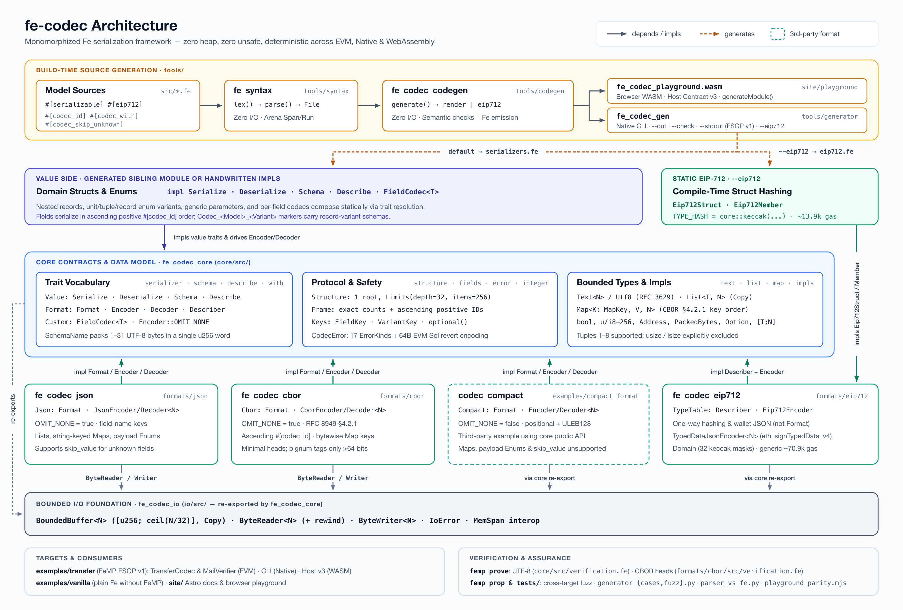

# Fe Codec

[](https://github.com/emeieiron/fe-codec/actions/workflows/tests.yml)
[](https://github.com/emeieiron/fe-codec/actions/workflows/femp.yml)

Fe Codec is a **type-safe**, **extensible** serialization framework for Fe. Describe a type once: a
generator written in Fe writes its serializers, and the same code encodes it as **JSON**,
deterministic **CBOR** or a **format you write**, and hashes it as **EIP-712** typed data, in **smart
contracts**, **native** programs and **WebAssembly**, with fixed-capacity buffers and explicit limits.

**[Documentation](https://emeieiron.github.io/fe-codec/)** ·
**[Playground](https://emeieiron.github.io/fe-codec/playground/)**, the generator running in your browser

## Why Fe Codec

Fe contracts and the programs around them exchange structured data: JSON for APIs and
indexers, canonical CBOR wherever equal values must give equal bytes (hashes, storage,
signatures), and EIP-712 typed data for wallet signatures. Fe has nothing like serde: no derive
macros, no reflection, and no heap in a contract. So each project writes encoders by hand, per
type and per format, and gets canonical output, strict decoding, bounds and agreement between
its EVM, native and WebAssembly builds only as far as it tests for them.

Fe Codec is for Fe developers who write contracts, and the native and WebAssembly code that has
to read and write the same bytes.

## Getting started

The runtime ingots are plain Fe and work with the official `fe` toolchain, version 26.7.0.
FeMP is optional: it can run the generator for you and test across targets, but nothing you
ship depends on it.

**1. Install `fe_codec_gen`** (Linux x86-64/ARM64, macOS Apple silicon):

```sh
curl -fsSL https://github.com/emeieiron/fe-codec/releases/latest/download/installer.sh | sh
```

Or build from source: `fe build --backend native tools/generator --out-dir ~/.local/bin`.

Because Fe 26.7.0 has no derive macros or compile-time reflection, `fe_codec_gen` parses
`#[serializable]` types outside the compiler and emits plain Fe trait impls; prebuilt binaries
keep consumers and CI (`--check`) from having to clone and build it.

**2. Add the ingots to `fe.toml`**, pinned to the release commit hash listed on each release
page (add `fe_codec_cbor` or `fe_codec_eip712` the same way — see
[Ingots and tools](#ingots-and-tools)):

```toml
[dependencies]
fe_codec_core = { source = "https://github.com/emeieiron/fe-codec.git", rev = "<commit>", name = "fe_codec_core" }
fe_codec_json = { source = "https://github.com/emeieiron/fe-codec.git", rev = "<commit>", name = "fe_codec_json" }
```

**3. Mark your types `#[serializable]` and generate their serializers** (`--check` in CI):

```fe
#[serializable]
pub struct Order {
    pub id: u64,
    pub buyer: Address,
    pub total: u256,
    pub note: Option<Text<32>>,
}
```

```sh
fe_codec_gen --source src/models.fe --out src/serializers.fe
```

**4. Encode and decode:**

```fe
let bytes: BoundedBuffer<192> = fe_codec_json::encode(order)?
let back: Order = fe_codec_json::decode(bytes)?
```

[Getting started](docs/getting-started.md) continues from here.

## How it works

Fe Codec splits serialization into three parts that meet in ordinary Fe traits:

- **The value side.** Each model type implements `Serialize`, `Deserialize` and `Schema`,
  written by `fe_codec_gen` from its `#[serializable]` declaration or by hand. Fields compose
  through trait resolution, across modules, ingots and generics.
- **The data model.** `Encoder` and `Decoder` in `fe_codec_core` are the vocabulary every
  format speaks: integers up to 256 bits, text, bytes, options, records, sequences, maps and
  enum variants.
- **The formats.** JSON, deterministic CBOR and EIP-712 each implement that vocabulary over a
  fixed-capacity buffer with depth and item limits. A third party adds a format the same way
  (`examples/compact_format`).

Generic code is monomorphized per value type and format: no runtime dispatch, allocation or
reflection, so one serializer runs in a contract, a native binary and WebAssembly.



### Ingots and tools

| Ingot / tool | Role |
| --- | --- |
| `fe_codec_core` | `Serialize`/`Deserialize`, the `Encoder`/`Decoder` data model, `Format`, schemas, errors, limits, `Text<N>`, `List<T, N>`, `Map<K, V, N>`, byte I/O |
| `fe_codec_io` | Bounded buffers, re-exported by core |
| `fe_codec_json` | Compact JSON |
| `fe_codec_cbor` | Deterministic CBOR (RFC 8949 §4.2.1) |
| `fe_codec_eip712` | EIP-712 struct hashes, signing digests and wallet requests |
| `fe_codec_gen` | Writes `Serialize`, `Deserialize`, `Schema` and `Describe` impls for `#[serializable]` types, and with `--eip712` static EIP-712 hashing for `#[eip712]` structs |

## Fe highlight

**One serializer per type, specialized per format at compile time.** `Encoder` is a Fe trait
with an associated const and associated types, and each format fills them in:

```fe
pub trait Encoder {
    const OMIT_NONE: bool
    type Record
    type Sequence
    fn begin_record<R: Schema>(mut self, _ present: usize) -> CodecResult<Self::Record>
    // ...
}

impl<const N: usize> Encoder for JsonEncoder<N> {
    const OMIT_NONE: bool = true    // keyed: leave None fields out
    type Record = Frame
    // ...
}

impl<const N: usize> Encoder for CompactEncoder<N> {
    const OMIT_NONE: bool = false   // positional: write every field
    type Record = Frame
    // ...
}
```

For the `Order` struct above, the generator writes one `serialize`, generic over the encoder,
and reads the const as if it were a value:

```fe
impl fe_codec_core::Serialize for Order {
    fn serialize<CodecEncoder: fe_codec_core::Encoder>(self, _ encoder: mut CodecEncoder) -> fe_codec_core::CodecResult<()> {
        var present: usize = 3
        if !CodecEncoder::OMIT_NONE || self.note.is_some() {
            present += 1
        }
        var record = encoder.begin_record<Self>(present)?
        // ... one field(...) and serialize(...) per field, in ID order
        encoder.end_record(record)
    }
}
```

Fe monomorphizes `serialize` for each encoder, so `CodecEncoder::OMIT_NONE` is a
compile-time constant in each copy, not a flag read at run time. A record's bookkeeping is the
format's own associated `Record` type, held on the stack by the serializer. Const generics
carry the buffer capacity the same way: in
`let bytes: BoundedBuffer<192> = fe_codec_json::encode(order)?`, Fe infers `N` of
`encode<T, const N: usize>` from the annotation. The result is one generated impl that serves
every format on every target, with nothing decided at run time.

## Limitations

| Compiler / toolchain limit | Current workaround | Cleaner solution |
| --- | --- | --- |
| No derive/proc macros or compile-time reflection | External `fe_codec_gen` + `fe_syntax` parser, sibling `.fe` files, `pub` fields required, no `where` or generic enums, separate `--eip712` pass | Compiler-integrated `#[derive(...)]` or compile-time reflection + `const fn` inside the defining module |
| No safe uninitialized array init; `unsafe` propagates to callers | Zero `unsafe` in `core`; `T: Copy` / `V: Copy` on generic `[T; N]`, `List<T, N>`, `Map<K, V, N>`; no generic `[T; 0]`; unrolled field arrays up to 64 | Safe `core` array init (`try_from_fn` / `MaybeUninit`) or library-encapsulated `unsafe` |
| No variadic generics | Hand-written tuple impls capped at 1–8 elements | Variadic generics or macro expansion in `core` |
| Full-SHA Git pinning; no codegen dependencies | Manual 40-char `rev` synced with `fe_codec_gen` | SemVer/registry dependencies and toolchain-managed codegen |

See [Design and guarantees](docs/design.md) for the full design rationale and verification
scope.

## Documentation

- [Getting started](docs/getting-started.md)
- [Types and limits](docs/types.md): what can be serialized, buffers, errors and schema evolution
- [The generator](docs/generator.md): every option, its diagnostics, and running it from FeMP
- [EIP-712](docs/eip712.md): hashing and signing typed data
- [Writing serializers](docs/writing-serializers.md) and [writing a format](docs/writing-a-format.md)
- [Wire profiles](docs/formats.md): exactly what each format writes
- [Design and guarantees](docs/design.md): what is proved, what is tested, and what is not established

## Developing Fe Codec

```text
ingots/                  runtime ingots: core, io, json, cbor, eip712
tools/                   fe_codec_gen, its core fe_codec_codegen and its parser fe_syntax
examples/vanilla/        plain-Fe consumer, used by tests/vanilla.py
examples/transfer/       FeMP project: conformance, properties, proofs, platform demos
examples/compact_format/ third-party format example
tests/                   generator suites, consumer checks and reference vector encoders
docs/                    the documentation, published by site/
site/                    the documentation site and its playground (Astro)
```

### CI and local checks

- The [tests workflow](.github/workflows/tests.yml) runs the checks that need only `fe`,
  Python and Node on every push. [tools/README.md](tools/README.md) describes the generator's
  suites.
- The [FeMP workflow](.github/workflows/femp.yml) runs the FeMP checks on every push to `main`
  that touches the code: tests on every target, property tests with seed `0x2a`, proofs, and a
  clean consumer project. Each run's summary shows the reports.

Run the FeMP suite and clean consumer check locally:

```bash
cd examples/transfer && femp test -t evm -t native -t wasm && femp prop -t evm -t native -t wasm --seed 0x2a && femp prove
python3 tests/consumer.py
```

The generator fuzz test exhausts a hosted runner, so it runs only locally:

```bash
python3 tests/generator_fuzz.py
```

After changing `tools/` or the codec ingots, rebuild the playground's WebAssembly module
(requires `femp`) and verify parity:

```bash
site/scripts/build-playground.sh && node tests/playground_parity.mjs
```

## License

[Apache License 2.0](LICENSE).
